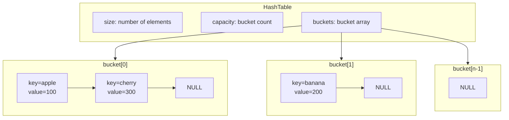
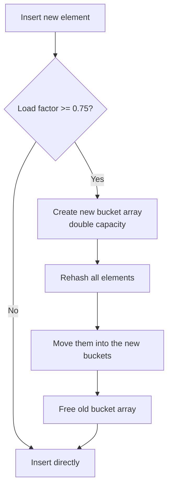

# Hash Table in C

[](https://en.wikipedia.org/wiki/C99)
[](LICENSE)

## Overview

A hash table implementation in C. It uses separate chaining for collisions and resizes automatically to keep the load factor in a reasonable range.

## Features

- Separate chaining for collision handling
- Resizes up when the load factor reaches 0.75
- Resizes down when the load factor drops to 0.125
- DJB2 string hashing
- Full API: insert/update, lookup, delete, iterate, and print state
- Allocation checks and cleanup on destroy

## Data Structure



## Core Algorithm

### DJB2 Hash

```c
static unsigned long hashString(const char* str) {
    unsigned long hash = 5381;
    int c;
    while ((c = *str++)) {
        hash = ((hash << 5) + hash) + c; // hash * 33 + c
    }
    return hash;
}
```

### Resize-Up Flow



## API

| Function | Description | Time complexity |
| --------------------- | --------------- | ---------- |
| `hashTableCreate()` | Create a hash table | O(1) |
| `hashTableDestroy()` | Destroy a hash table | O(n) |
| `hashTablePut()` | Insert or update a key-value pair | O(1) amortized |
| `hashTableGet()` | Get a value by key | O(1) average |
| `hashTableRemove()` | Remove a key-value pair | O(1) average |
| `hashTableContains()` | Check whether a key exists | O(1) average |
| `hashTableSize()` | Get the number of elements | O(1) |
| `hashTableIsEmpty()` | Check whether the table is empty | O(1) |
| `hashTableKeys()` | Get all keys | O(n) |
| `hashTablePrint()` | Print the table state | O(n) |

## Build and Run

### Build

```bash
gcc -o hash_table hash_table.c -std=c99
```

Replace `hash_table.c` with your actual source filename if it differs.

### Run

```bash
./hash_table
```

## Example

```c
#include <stdio.h>

int main() {
    // Create a hash table
    HashTable* ht = hashTableCreate();

    // Insert key-value pairs
    hashTablePut(ht, "apple", 100);
    hashTablePut(ht, "banana", 200);
    hashTablePut(ht, "cherry", 300);

    // Look up a value
    int value;
    if (hashTableGet(ht, "apple", &value)) {
        printf("apple = %d\n", value);  // prints: apple = 100
    }

    // Check whether a key exists
    if (hashTableContains(ht, "banana")) {
        printf("banana exists\n");
    }

    // Remove a key-value pair
    hashTableRemove(ht, "banana");

    // Print the table state
    hashTablePrint(ht);

    // Destroy the table
    hashTableDestroy(ht);

    return 0;
}
```

## Sample Output

```
C:\Users\anjuxi\Desktop\hash_table>a.exe
=== Hash Table Test ===

[Basic operations]
Insert 5 key-value pairs

=== Hash table state ===
Size: 5
Capacity: 16
Load factor: 0.31
-------------------
Bucket[ 0]: NULL
Bucket[ 1]: NULL
Bucket[ 2]: (cherry=300)
Bucket[ 3]: (date=400)
Bucket[ 4]: NULL
Bucket[ 5]: (elderberry=500)
Bucket[ 6]: (banana=200)
Bucket[ 7]: (apple=100)
Bucket[ 8]: NULL
Bucket[ 9]: NULL
Bucket[10]: NULL
Bucket[11]: NULL
Bucket[12]: NULL
Bucket[13]: NULL
Bucket[14]: NULL
Bucket[15]: NULL
===================

Lookup 'banana': 200
Lookup 'apple': 100

[Update test]
After update, 'apple': 150

[Delete test]
Remove 'banana'

=== Hash table state ===
Size: 4
Capacity: 16
Load factor: 0.25
-------------------
Bucket[ 0]: NULL
Bucket[ 1]: NULL
Bucket[ 2]: (cherry=300)
Bucket[ 3]: (date=400)
Bucket[ 4]: NULL
Bucket[ 5]: (elderberry=500)
Bucket[ 6]: NULL
Bucket[ 7]: (apple=150)
Bucket[ 8]: NULL
Bucket[ 9]: NULL
Bucket[10]: NULL
Bucket[11]: NULL
Bucket[12]: NULL
Bucket[13]: NULL
Bucket[14]: NULL
Bucket[15]: NULL
===================

'banana' exists: no
[Resize-up test]
Insert more elements to trigger resize...

=== Hash table state ===
Size: 14
Capacity: 32
Load factor: 0.44
-------------------
Bucket[ 0]: (lemon=1000)
Bucket[ 1]: (papaya=1400) -> (orange=1300)
Bucket[ 2]: NULL
Bucket[ 3]: (date=400)
Bucket[ 4]: NULL
Bucket[ 5]: NULL
Bucket[ 6]: NULL
Bucket[ 7]: NULL
Bucket[ 8]: (honeydew=800)
Bucket[ 9]: NULL
Bucket[10]: (quince=1500)
Bucket[11]: NULL
Bucket[12]: NULL
Bucket[13]: NULL
Bucket[14]: NULL
Bucket[15]: NULL
Bucket[16]: NULL
Bucket[17]: NULL
Bucket[18]: (cherry=300)
Bucket[19]: NULL
Bucket[20]: (grape=700)
Bucket[21]: (elderberry=500)
Bucket[22]: NULL
Bucket[23]: (apple=150) -> (mango=1100)
Bucket[24]: NULL
Bucket[25]: (kiwi=900)
Bucket[26]: NULL
Bucket[27]: (fig=600)
Bucket[28]: NULL
Bucket[29]: NULL
Bucket[30]: (nectarine=1200)
Bucket[31]: NULL
===================

[Iterate all keys]
All keys (14): lemon papaya orange date honeydew quince cherry grape elderberry apple mango kiwi fig nectarine

[Collision test]
Insert keys likely to collide...

=== Hash table state ===
Size: 17
Capacity: 32
Load factor: 0.53
-------------------
Bucket[ 0]: (lemon=1000)
Bucket[ 1]: (papaya=1400) -> (orange=1300)
Bucket[ 2]: NULL
Bucket[ 3]: (date=400)
Bucket[ 4]: NULL
Bucket[ 5]: NULL
Bucket[ 6]: NULL
Bucket[ 7]: NULL
Bucket[ 8]: (honeydew=800)
Bucket[ 9]: NULL
Bucket[10]: (quince=1500)
Bucket[11]: (bac=3) -> (cba=2) -> (abc=1)
Bucket[12]: NULL
Bucket[13]: NULL
Bucket[14]: NULL
Bucket[15]: NULL
Bucket[16]: NULL
Bucket[17]: NULL
Bucket[18]: (cherry=300)
Bucket[19]: NULL
Bucket[20]: (grape=700)
Bucket[21]: (elderberry=500)
Bucket[22]: NULL
Bucket[23]: (apple=150) -> (mango=1100)
Bucket[24]: NULL
Bucket[25]: (kiwi=900)
Bucket[26]: NULL
Bucket[27]: (fig=600)
Bucket[28]: NULL
Bucket[29]: NULL
Bucket[30]: (nectarine=1200)
Bucket[31]: NULL
===================

'abc' = 1
'cba' = 2
'bac' = 3

[Lookup missing key]
'nonexistent' not found (expected)

=== All tests finished ===
```

## Parameters

| Parameter | Default | Description |
| ------------------------- | ------ | ---------- |
| `INITIAL_CAPACITY` | 16 | Initial bucket count |
| `LOAD_FACTOR_THRESHOLD` | 0.75 | Resize-up threshold |
| `SHRINK_FACTOR_THRESHOLD` | 0.125 | Resize-down threshold |

## Dependencies

Only the standard C library:

- `stdio.h` — input/output
- `stdlib.h` — memory allocation
- `stdbool.h` — boolean type
- `string.h` — string operations

## Author

**Ailan Anjuxi (谙弆悕博士)**

- Email: [anjuxi.ME@outlook.com](mailto:anjuxi.ME@outlook.com)
- SIP: [sip:anjuxi@sip.linphone.org](sip:anjuxi@sip.linphone.org)

---

*This project is for learning and teaching. Discussion and feedback are welcome.*
